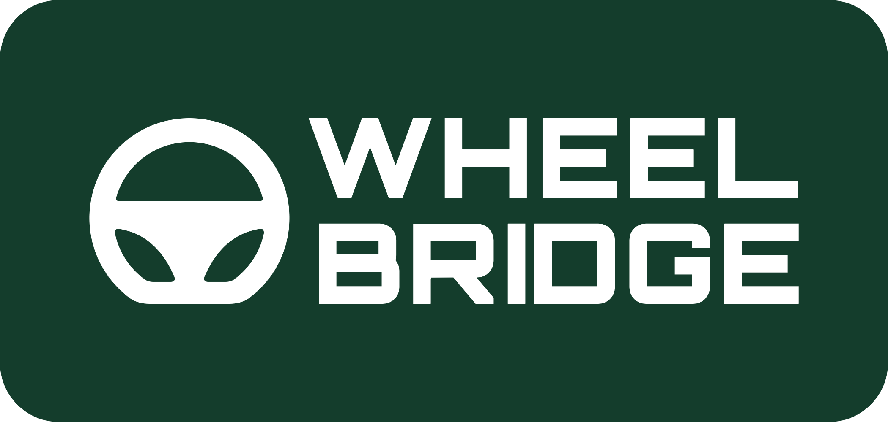
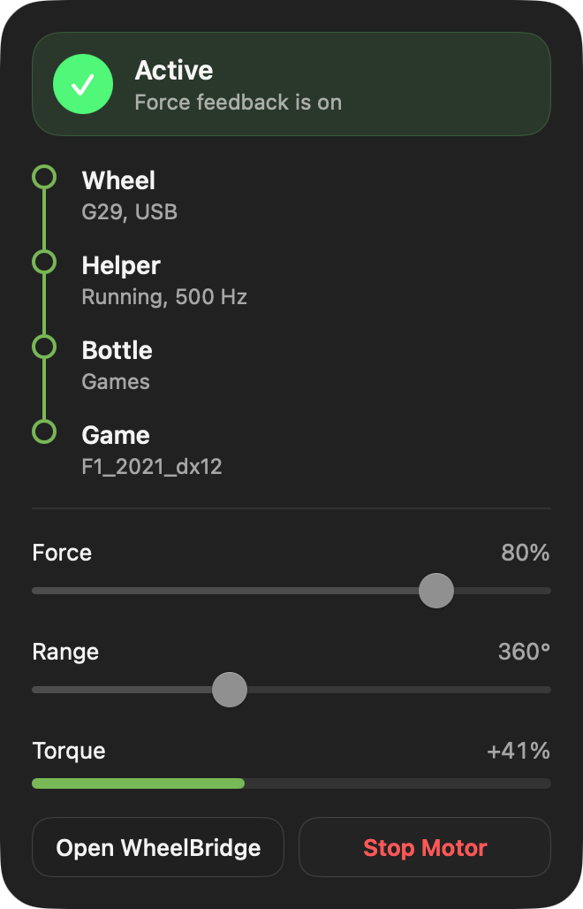
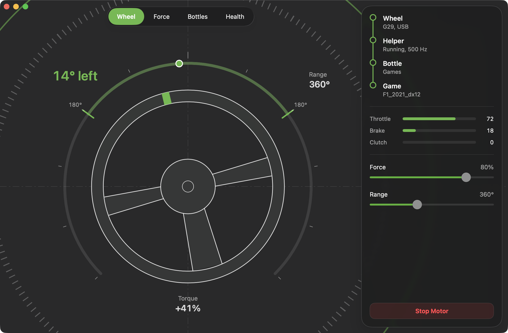
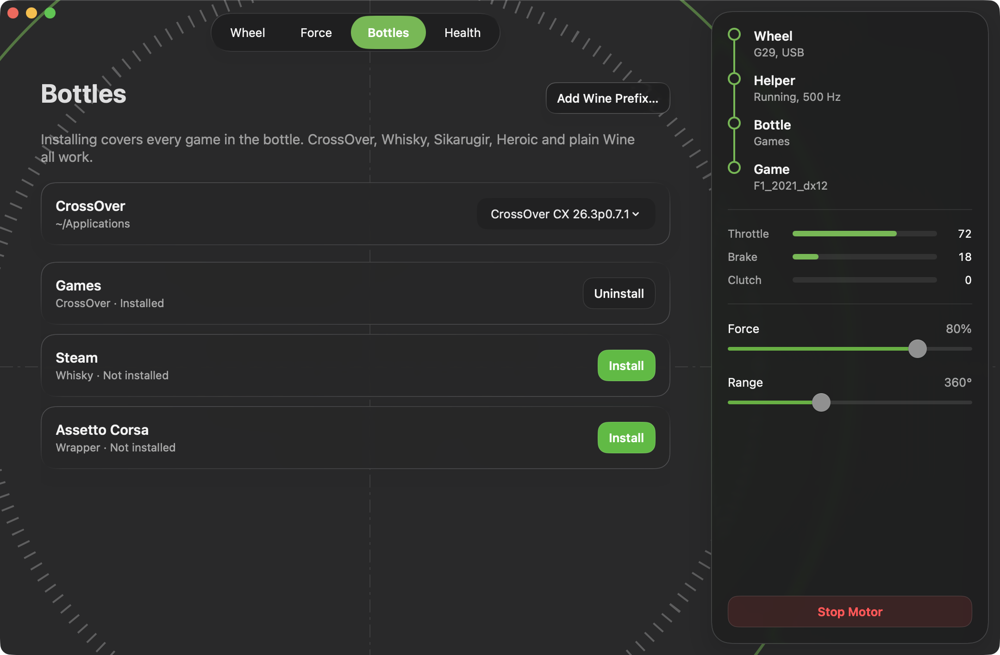
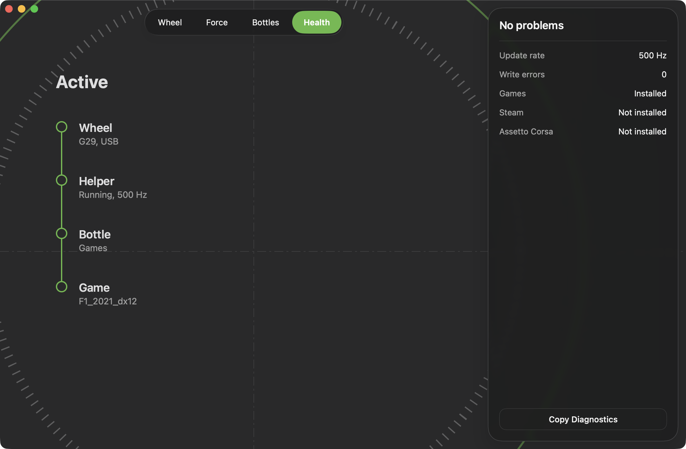

<p align="center">
  
</p>

# WheelBridge

<p align="center">
  <b>Force feedback for your racing wheel, in Windows games on your Mac</b>
</p>
<p align="center">
  Feel the road in sims running under CrossOver, Whisky, Heroic or any other Wine.
</p>

<div align="center">

  
  
  

</div>

<br>

## &nbsp; The Problem
Plug a Logitech wheel into a Mac, start a racing game in CrossOver, and the wheel steers. It just never pushes back.

<table width="100%">
  <tr>
    <td width="33%" valign="top" align="center">
      <br>
      <h3 align="center">&nbsp; No Force Feedback</h3>
      <p align="center">Wine only offers force feedback on devices that describe it in their HID descriptor. Logitech wheels don't, so games see a wheel with no motor.</p>
      <br>
    </td>
    <td width="33%" valign="top" align="center">
      <br>
      <h3 align="center">&nbsp; Locked Down macOS</h3>
      <p align="center">Giving macOS a virtual force feedback device needs entitlements Apple hands out case by case. The usual workaround is turning off SIP.</p>
      <br>
    </td>
    <td width="33%" valign="top" align="center">
      <br>
      <h3 align="center">&nbsp; Half Answers</h3>
      <p align="center">The existing tools are paid and closed, or cover one wheel, 64-bit games only, or CrossOver only. Some break on every CrossOver or macOS update.</p>
      <br>
    </td>
  </tr>
</table>

<br>

## &nbsp; The Solution
WheelBridge fakes the wheel **inside the bottle** instead of inside macOS. A small `dinput8.dll` goes into the Wine prefix and shows games a G29 that supports every DirectInput effect. The effects travel through shared memory to a helper on the Mac, which works out the torque and writes it to the real wheel. No kext, no root, no SIP change.

### How it works

1.  **Install:** the app finds your bottles and prefixes, copies that Wine's own `dinput8.dll` aside, and puts the proxy in its place with a `native,builtin` override. Everything it changes is backed up, and uninstall puts the bottle back byte for byte.
2.  **Game:** the game opens DirectInput and finds a G29 with force feedback. It creates and plays effects as it would on Windows: constant, periodic, ramp, spring, damper, friction and inertia.
3.  **Bridge:** the proxy writes the effects into shared memory with seqlocks, so neither side ever waits on the other. Steering, pedals and buttons come back the same way.
4.  **Helper:** `wheelbridged` runs the effects at 500 Hz against the wheel's real position and speed, applies your strength and range, and sends one torque report to the wheel.
5.  **Repair:** when a CrossOver update replaces Wine's `dinput8.dll`, the bottle shows "Made for a different CrossOver version", and Repair fixes it in one click.

> Kunos games (Assetto Corsa, ACC, AC EVO) also look for Logitech's SDK, which needs G HUB. It finds no wheel under Wine, and the games fall back to DirectInput. Set the steering lock in the game to match the range in WheelBridge.

<br>

## &nbsp; Safety Model
A motor that keeps pushing after a game crashes can hurt a wrist. The helper's rule is simple: **in any doubt, no force.**

| **When**                      | **What the motor does**                                                                                |
| :---------------------------- | :----------------------------------------------------------------------------------------------------- |
| **No game running**           | Nothing. The wheel's own centring spring is off and no torque is sent.                                 |
| **Game stalls or crashes**    | The proxy's heartbeat stops. After half a second the helper releases the motor.                        |
| **Game pauses**               | Paused or actuators-off from DirectInput releases the motor until the game continues.                  |
| **Helper quits**              | It sends the wheel's stop command on the way out, and again if it loses the wheel.                     |
| **Wheel unplugged**           | The helper drops it, and starts it from scratch when it comes back, in whatever mode it returns in.    |
| **Stop Motor**                | One button in the menu bar, and the motor stays released until you turn it back on.                    |
| **Bad data**                  | Torque that isn't a number becomes zero, and every value is clamped to the motor's range.              |

The app only edits settings. It never talks to the wheel, so a bug in the interface can't move the motor. The helper never seizes the device either, so macOS and Wine still see your steering, pedals and buttons.

<br>

## &nbsp; Tech Stack
SwiftUI on the Mac, plain C inside Wine, and one header both sides compile. No libraries: the DirectInput proxy, the effect engine and the Logitech protocol are all written here.

| **Component**        | **Technology**                                                                                                | **Description**                                                                            |
| :------------------- | :------------------------------------------------------------------------------------------------------------ | :----------------------------------------------------------------------------------------- |
| **Mac app**          |                                        | SwiftUI menu bar panel and window with Liquid Glass. Bottles, live wheel view, settings and health checks. |
| **Helper**           |                                              | `wheelbridged`, a LaunchAgent. IOKit HID, the effect engine and the motor rules.            |
| **Proxy**            |                                          | `dinput8.dll` for 32-bit and 64-bit games, built with mingw-w64. Forwards everything else to Wine's own copy. |
| **Shared memory**    |     | One C header, `wheelbridge_bridge.h`: a fixed layout with seqlocks, read by both sides.      |
| **Wine**             |                    | Any Wine 6 or newer: CrossOver, Whisky, Sikarugir, Kegworks, Wineskin, Heroic, Game Porting Toolkit. |

<br>

## &nbsp; Visuals

<table width="100%">
  <tr>
    <th width="28%">Menu bar</th>
    <th width="72%">Wheel</th>
  </tr>
  <tr>
    <td valign="middle"></td>
    <td valign="middle"></td>
  </tr>
</table>

| Bottles | Health |
| :---: | :---: |
|  |  |

<br>

## &nbsp; What Works

| **Wheels**                                    | **Games**                                         | **Launchers**                                     |
| :-------------------------------------------- | :------------------------------------------------ | :------------------------------------------------ |
| G29 (tested)                                  | F1 2021 (tested)                                  | CrossOver (tested)                                |
| G923 for PlayStation, G27, G25                | Assetto Corsa, ACC, AC EVO                        | Whisky                                            |
| Driving Force GT, Pro, EX                     | BeamNG.drive                                      | Sikarugir, Kegworks, Wineskin                     |
| MOMO Force, MOMO Racing                       | rFactor 2, LMU, iRacing, RaceRoom, AMS2, DiRT, WRC | Heroic, Game Porting Toolkit, plain Wine          |

Only the tested ones have been tried on real hardware. The rest follow published protocol notes and pass the test suite below. The G920, the Xbox G923 and the PRO wheel are recognised but not driven yet, and TrueForce isn't supported. [docs/SUPPORT.md](docs/SUPPORT.md) has the details.

<br>

## &nbsp; Getting Started

### Install

1. **Build it** (below) and drag `build/WheelBridge.app` into Applications. Releases with a signed DMG are coming.
2. **Open it.** macOS asks for Input Monitoring, which the helper needs to read the wheel. The helper installs itself as a LaunchAgent and starts at login.
3. **Bottles:** pick your CrossOver if you have more than one, then click **Install** on each bottle you race in. Prefixes from other launchers show up on their own, and **Add Wine Prefix…** covers the rest.
4. **Race.** Plug in the wheel, start the game, and pick the Logitech G29 in its controls. The menu bar shows when force feedback is on.

If you ever installed G HUB, check for `/Library/Extensions/LogiWheelForceFeedback.kext`. It grabs the wheel and stalls USB, and WheelBridge's Health screen tells you how to remove it.

### Build from source

```bash
xcode-select --install && brew install mingw-w64
```

```bash
scripts/build-app.sh && open build/WheelBridge.app
```
This builds the app, the helper and both proxies, signed ad hoc. Set `SIGN_IDENTITY` to a Developer ID to sign for release.

### Test

```bash
cd mac && swift run wheelcore-check
```
Checks the protocol bytes for every wheel, every effect type, the motor safety rules, the shared memory, launcher discovery, and that uninstall restores a bottle byte for byte.

```bash
scripts/test-in-wine.sh /some/scratch/folder
```
Makes a throwaway CrossOver bottle and runs real stand-in games against the real proxies, plus a helper with a simulated wheel. A 32-bit and a 64-bit game each find the wheel, play a force and stall. Three more copy the DirectInput calls of the Kunos games, BeamNG.drive and SDL games. The script prints the exact reports the motor would receive, and never touches your own bottles.

```bash
open -n build/WheelBridge.app --args --preview good
```
Shows every screen with sample data, no helper or bottle needed.

<br>

## &nbsp; Roadmap
- [x] **Proxy:** `dinput8.dll` for 32-bit and 64-bit games, forwarding to Wine's own copy
- [x] **Effect engine:** every DirectInput effect, computed on the Mac at 500 Hz
- [x] **Motor safety:** releases on stall, pause, quit and unplug, plus a Stop Motor button
- [x] **Exact uninstall:** backups, a manifest, and a bottle restored byte for byte
- [x] **CrossOver updates:** detected, with one-click repair
- [x] **Classic Logitech wheels:** G29, G923 PS, G27, G25, DFGT, DFP, Driving Force, MOMO
- [x] **Mode switching:** wheels in compatibility mode are told to come back as themselves
- [x] **Other launchers:** Whisky, Sikarugir, Kegworks, Wineskin, Heroic, plain Wine and Game Porting Toolkit
- [x] **Live wheel view:** steering, pedals, torque and range at a glance
- [x] **Tested on hardware:** G29 in F1 2021 under CrossOver
- [ ] **Signed, notarized DMG** and GitHub releases
- [ ] **HID++ wheels:** G920 and the Xbox G923
- [ ] **Generic PID driver** for direct drive bases (Moza, Simagic, Simucube, Cammus, OpenFFBoard)
- [ ] **Thrustmaster and Fanatec**
- [ ] **Simulated TrueForce** from game telemetry
- [ ] **More hardware reports:** other wheels, games and launchers

<br>

## &nbsp; Acknowledgements
- [new-lg4ff](https://github.com/berarma/new-lg4ff) and Linux's `hid-lg4ff`: the reference for every Logitech byte here. Only protocol facts are used, no code
- [Wine](https://www.winehq.org) and [CodeWeavers](https://www.codeweavers.com): for making Windows games run on a Mac at all
- [crossover-ffb](https://github.com/0xbiel/crossover-ffb): for the virtual device and shared memory design, and the lesson that a killed app can leave a force held
- [CrossFFB](https://github.com/teosemi/CrossFFB) and [crossover-wheel](https://github.com/renaudallard/crossover-wheel): for mapping out what breaks, and where
- [Bridge](https://github.com/Bonevane/Bridge): WheelBridge's older sibling

WheelBridge is released under the [Apache License 2.0](LICENSE). See `NOTICE` for details.

<br>

<div align="center">

[](https://github.com/bonevane)
[](https://bonevane.dev)
[](mailto:rahmad.atomic44@gmail.com)

</div>

<p align="center">
  <sub>Made with &nbsp;<sub></sub>&nbsp; by Bonevane</sub>
</p>
